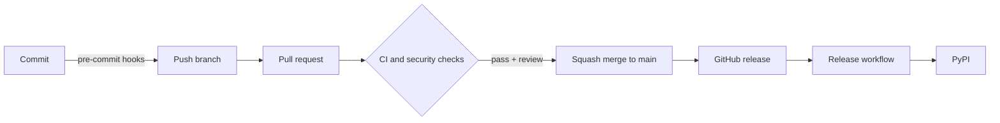
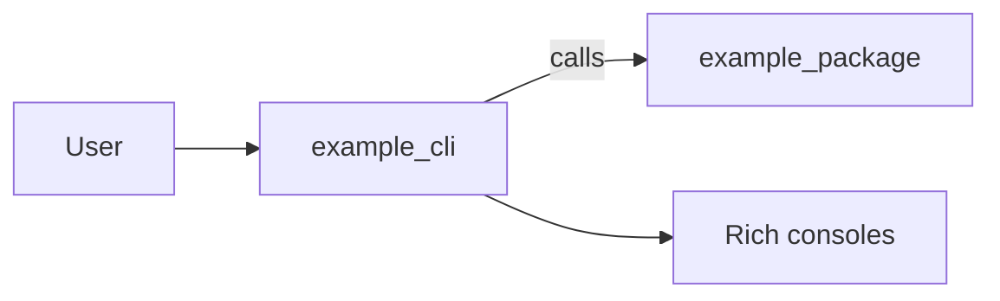

# Architecture

How the pieces of this template fit together. For day-to-day commands, see [development](development.md). For one-time repository settings, see [repository setup](repo-setup.md).

## Overview

A change moves through three layers of checks before it reaches `main`, and a release moves through one more before it reaches PyPI.



## Layers

| Layer | What runs | Where |
| --- | --- | --- |
| Local | gitleaks, file hygiene, markdownlint, Ruff, `uv lock` check, mypy, Sweepito scan and cleanup | pre-commit hooks |
| Pull request | `ci` (per package: lint, unit and integration tests on Python 3.11 to 3.15 on Ubuntu plus 3.11 on Windows and macOS, build), dependency review, Semgrep, CodeQL | GitHub Actions |
| Repository | Branch ruleset, secret scanning with push protection, Dependabot alerts and updates | GitHub settings |
| Release | Tag and version check, build, trusted publish to PyPI, per package | `release.yml` |

## Source layout

```text
packages/core/src/example_package/   typed library: all the logic, never prints or exits
packages/core/tests/                 core tests with coverage (80% minimum); tests/integration/ is marked `integration`
packages/cli/src/example_cli/        Typer + Rich command line over the library
packages/cli/tests/                  command line tests; tests/integration/ is marked `integration`
packages/docker/                     Dockerfile and docs of the container image (built from core and cli)
installer/                           Windows setup (NSIS), Linux deb and rpm (nfpm) of the command line, built with PyInstaller
brand/                               sample icon and setup artwork used by the installers
packages/*/pyproject.toml            each package's metadata, dependencies and tool configuration
pyproject.toml                       uv workspace root: dev dependencies and shared tool configuration
uv.lock                              locked dependency set, checked by CI with --locked
```

The repository is a uv workspace of two Python packages that are built, tested, versioned and released separately: `example-package` (`packages/core`) and `example-cli` (`packages/cli`, which depends on the core). The Docker image (`packages/docker`) and the installers (`installer/`) are released separately too, from the same sources. Each version lives in one place, `__version__` in the package, and Hatchling reads it at build time. The release workflow compares it with the release tag.

## Library and CLI layers



- `example_cli` parses arguments with Typer, calls `example_package`, and writes all output through the shared Rich consoles: data to stdout, messages and errors to stderr.
- `example_package` holds the logic. It raises exceptions instead of printing or exiting, so other front ends can reuse it.
- The console script `example-cli` and `python -m example_cli` both enter through `example_cli.cli:app`. The two packages ship as separate wheels; `--version` reports `example_package.__version__`.

## Workflows

| Workflow | Trigger | Purpose |
| --- | --- | --- |
| `ci.yml` | Pull request, push to `main` | Calls `ci-core.yml`, `ci-cli.yml` (lint, test, integration test, build), `ci-docker.yml` (builds and checks the image), `ci-installer.yml` (builds, installs and removes the installers, after the cli passed) and `ci-repo.yml` (everything outside `packages/`). `changes.yml` limits a pull request to the parts it touches. A final `ci` job gates on all of them and is the only check the ruleset requires. |
| `security.yml` | Pull request, push to `main`, weekly, manual | Calls `security-core.yml`, `security-cli.yml`, `security-docker.yml` (Semgrep, Trivy on the Dockerfile and, weekly, on the image) and `security-repo.yml`: Semgrep, uploaded to code scanning. Not a required check. |
| `dependency-review.yml` | Pull request | Blocks pull requests that add vulnerable dependencies. |
| `audit.yml` | Weekly, manual, and pull requests that change `uv.lock` | Calls `audit-core.yml`, `audit-cli.yml` and `audit-repo.yml`: `pip-audit` on each package's locked dependencies to catch newly published vulnerabilities. |
| `release.yml` | GitHub release published | Tag `vX.Y.Z` releases `example-package`, `cli-vX.Y.Z` releases `example-cli` (checks the tag matches the version, builds, publishes to PyPI), `installer-vX.Y.Z` attaches the installers to the release and `docker-vX.Y.Z` pushes the image to GHCR. |
| `init.yml` | Manual | One-time placeholder replacement in a repo created from the template. Skipped in the template itself. |

CodeQL runs through GitHub's default setup rather than a workflow file.

## Branch governance

The `main` ruleset in `.github/rulesets/main.json` is applied by `scripts/apply_repo_settings.py`. It requires:

- a pull request with a code owner review and resolved conversations, squash merge only
- the `ci` and `dependency-review` checks, with the branch up to date
- CodeQL results
- no deletion and no force push

Repository admins can bypass through a pull request so a solo maintainer is not locked out.

## Release flow

1. Bump `__version__` and update the package's `CHANGELOG.md` in a pull request.
2. After merge, publish a GitHub release tagged `v<version>` (core) or `cli-v<version>` (command line). Release the core first, because the command line depends on it.
3. `release.yml` builds the sdist and wheel in one job, then a second job in the package's environment (`core` or `cli`) publishes them using OpenID Connect. No API token is stored, and only the publish job gets the `id-token` permission.

## Template lifecycle

GitHub copies files, not settings. A new repo therefore needs three steps: run **Init** to replace the template owner and name, rename the example package, and run the settings script to apply protections and the ruleset.
