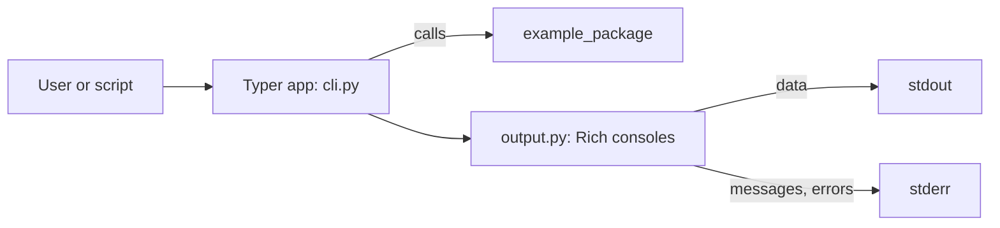

# Architecture

How `example-cli`, the command line, is built. It only parses input and shows output; the logic is in [`example-package`](../../core/docs/architecture.md).

## Overview

The package is `packages/cli/src/example_cli/`:

| Module | Purpose |
| --- | --- |
| `__init__.py` | The package's own `__version__`, read by Hatchling at build time. |
| `cli.py` | The Typer app: global options, the commands, and `run()`, the console script entry point. |
| `output.py` | The two Rich consoles and the helpers that write to them (`error`, `print_exception`). |
| `__main__.py` | Makes `python -m example_cli` start the same app. |
| `py.typed` | Marks the package as typed. |

## Rules

- **Thin commands.** A command parses its arguments, calls the library, and shows the result. Logic that is more than a few lines belongs in `example_package`, where it can be tested and reused without the terminal.
- **Output goes through `output.py`.** Results are written to stdout (`console`) so they can be piped; errors and extra detail go to stderr (`err_console`). Do not call `print` (Ruff's `T20` rule forbids it).
- **Exit codes are part of the interface.** `0` success, `1` the command failed, `2` invalid usage. A command that fails prints `Error: <message>` and raises `typer.Exit(code=1)`.
- **Global options live on the callback.** `--verbose`, `--quiet`, `--no-color` and `--version` are defined once in `cli.py` and shared through a `State` object on the Typer context. Each has an `EXAMPLE_CLI_` environment variable; a flag wins over the variable.
- **Errors are short.** `run()` catches unexpected exceptions and prints one line plus a hint. A traceback is shown only with `--verbose`, and never with local variables, because they can contain secrets.

## Entry points

- The console script `example-cli` is `example_cli.cli:run` (`[project.scripts]`).
- `python -m example_cli` runs the same `run()`.
- Tests call the Typer `app` directly with `typer.testing.CliRunner`.

## Versions

`example_cli.__version__` versions this package. `--version` reports the core library's version, because that is the code that does the work; change `_show_version` if you want the other. The command line depends on `example-package` without an upper bound; raise the minimum when you start using something newer.

## Adding a command

See [Adding a command](guides/cli.md#adding-a-command), and the [`hello` guide](guides/cli/hello.md) for a complete example.
