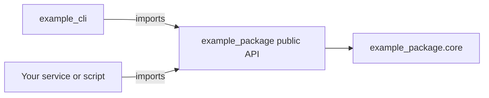

# Architecture

How `example-package`, the core library, is built. It holds all the logic of the project and nothing about how it is shown, so any front end (the command line, a service, a window) can reuse it.

## Overview

The package is `packages/core/src/example_package/`:

| Module | Purpose |
| --- | --- |
| `__init__.py` | The public API (`__all__`) and `__version__`, the one place the version lives. |
| `core.py` | The logic. Plain functions that take values and return values or raise exceptions. |
| `py.typed` | Marks the package as typed, so users' type checkers read its annotations. |

## Rules

- **No output, no exit.** The library never calls `print`, never writes to the console and never calls `sys.exit`. It returns results and raises exceptions; the front end decides how to show them. Ruff's `T20` rule enforces the first part.
- **Errors are exceptions.** Invalid input raises a standard exception (`ValueError` for the example) with a message that is safe to show to a user. Do not put secrets or whole inputs in messages.
- **One public surface.** What users may import is listed in `__all__` in `__init__.py`. Anything else, and anything prefixed with `_`, may change without notice.
- **Fully typed.** `mypy --strict` runs on the source and the tests. Annotate every function and keep `py.typed`.
- **No dependency on the front end.** The core never imports `example_cli`. The command line package depends on the core, not the other way round (`dependencies = []` in `pyproject.toml`; add libraries only when the logic needs them).

## Versioning

`__version__` in `example_package/__init__.py` is the single source. Hatchling reads it at build time (`[tool.hatch.version]`), the release workflow compares it with the tag `v<version>`, and the command line reports it with `--version`. The project follows [Semantic Versioning](https://semver.org/): the names in `__all__` are the public API.

## Adding to the library

1. Put the logic in a module of `example_package` as a function with full type annotations and a docstring that lists what it raises.
2. Export it from `__init__.py` and add it to `__all__`.
3. Test it in `tests/unit/` (see [development](development.md)), and document it in the [Python guide](guides/python.md).
4. Add a line under `[Unreleased]` in [`CHANGELOG.md`](../CHANGELOG.md).

When a module grows, turn it into a subpackage and keep the exports in `__init__.py`, so imports from `example_package` do not change.
